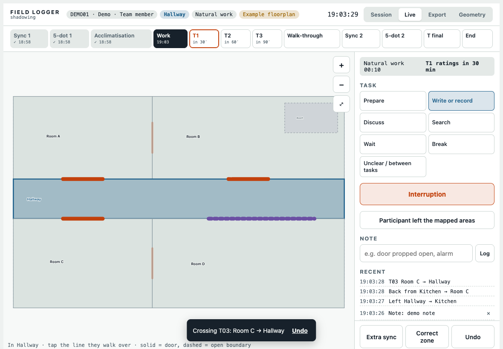
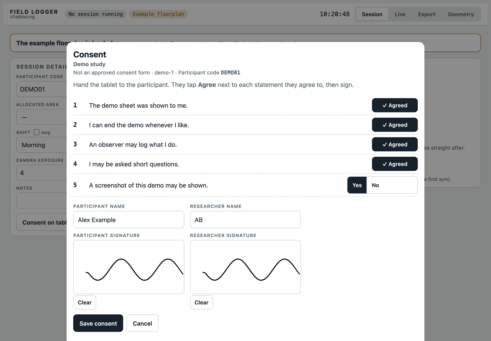
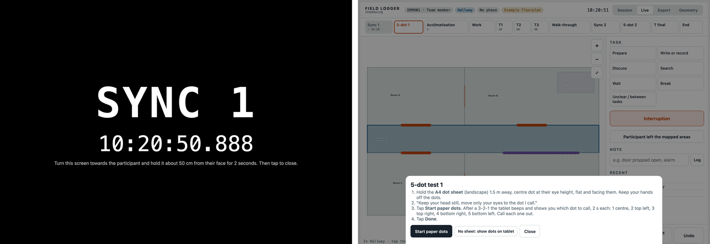
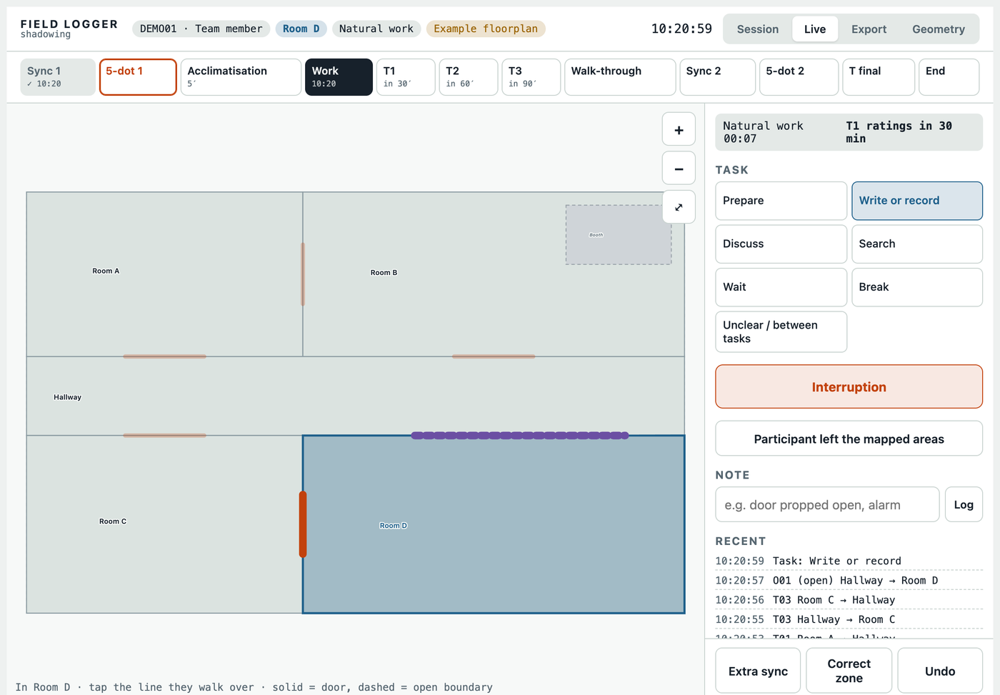
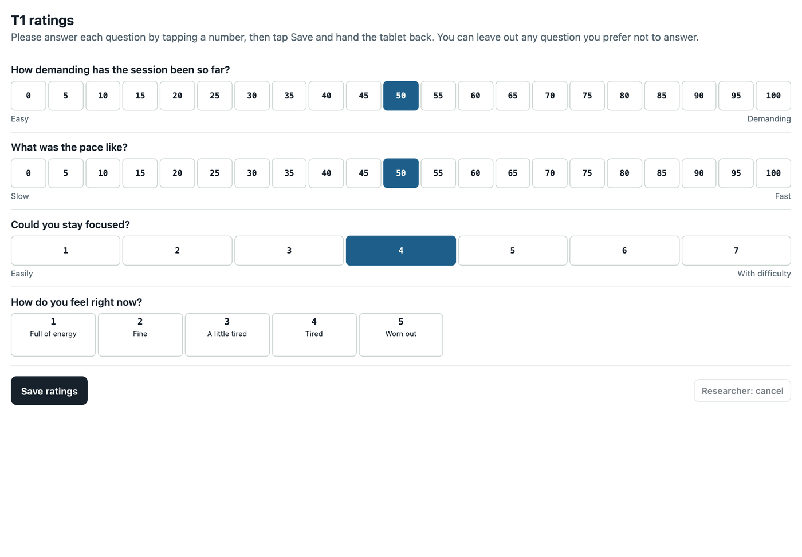
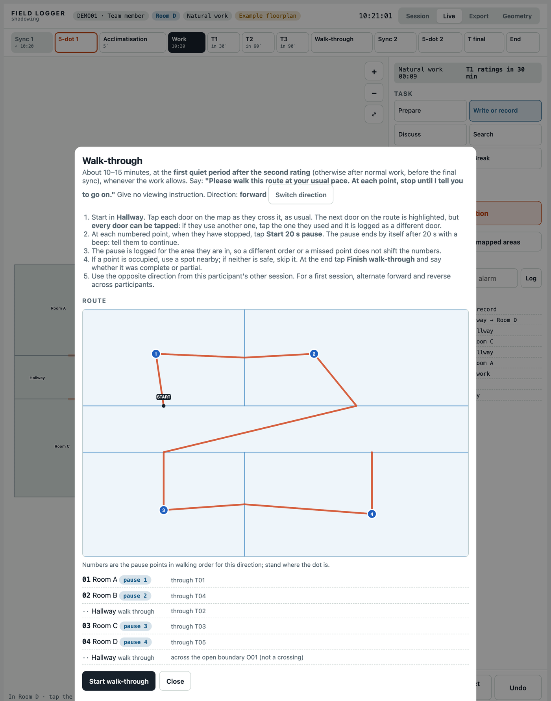
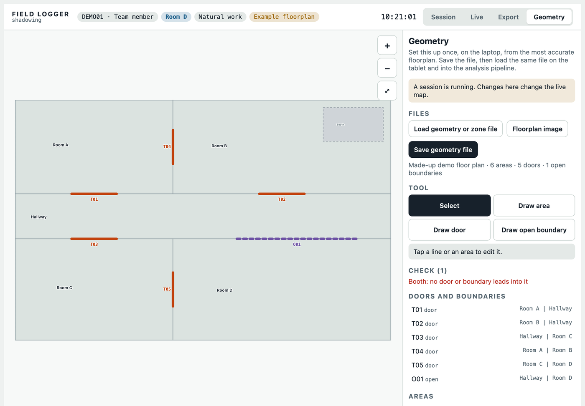
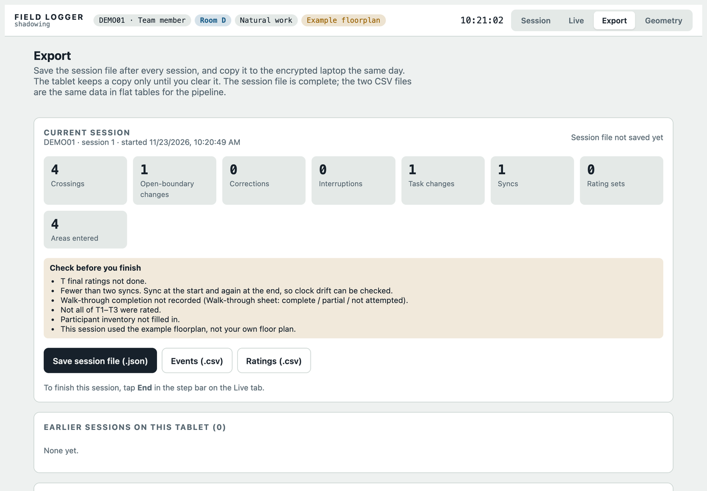

# field-logger

A tablet app for shadowing studies that use wearable sensors. An observer logs, on one clock, where a participant is, what they are doing, when they are interrupted and how they rate it.

Author: Salome Egli



- **Set-up:** consent with signatures on the tablet, a checklist and a participant inventory.
- **Sync:** a flashing clock to show to the scene camera, and 5-dot accuracy tests.
- **Live map:** tap doors and open boundaries as they are crossed. Rooms, leaving the mapped areas and corrections are logged separately.
- **Tasks, interruptions and notes:** Undo marks an entry void and never erases it.
- **Ratings:** three sets, due after set minutes of natural work with a minimum gap, plus final ratings with one per area.
- **Walk-through:** a fixed route with timed pauses, forward or reverse.
- **Geometry editor:** draw areas, doors and open boundaries on your own floor plan.
- **Export:** JSON and CSV, with consent records saved apart from session files.

## Screens

All screenshots use the made-up demo configuration in [config.js](config.js).

**Set-up and consent.** Statements agreed one by one, signatures on the tablet, the consent record kept apart from the session.



**Sync and 5-dot.** A flashing clock to the millisecond for the scene camera, then the five-dot accuracy test with a paper sheet or dots on the tablet.



**Live map.** Tap the line a participant walks over: solid for a door, dashed for an open boundary. Tasks, interruptions and notes sit beside the map, with the step bar on top.



**Ratings.** Three sets due after set minutes of natural work, plus final ratings with one item per area.



**Walk-through.** One route definition drives the steps, the line on the map, the numbering and the logging, forward or reverse.



**Geometry editor.** Draw areas, doors and open boundaries on your own floor plan. The editor checks that every area can be reached.



**Export.** Counts for the session, a check list before finishing, and the session file plus two CSV tables.



## Why it works this way

- **Threshold crossings are the event boundaries.** The observer does not estimate where someone is standing. They tap the door or open boundary at the moment it is crossed, which is a moment both the observer and the scene camera can see. Location then follows from the sequence of crossings, and every crossing can be checked against the video later.
- **Void, never erase.** Undo and corrections mark an entry void and log what replaced it. The record of what was tapped, and when, stays complete, so a correction can itself be reviewed.
- **Offline and local.** The app runs from the tablet's own storage with no server and no network. Nothing depends on a connection during a session, and nothing leaves the device until the observer exports it.
- **Consent kept apart from data.** Consent records, with names and signatures, are stored and exported separately from session files, which carry only the participant code.

## Run it

There is no build and there are no dependencies. Serve the folder:

```sh
python3 -m http.server 8000 --bind 127.0.0.1
```

Open <http://127.0.0.1:8000>, enter `DEMO01`, a role, a starting area, a camera exposure and the time the shift started, then tap Start session.

Offline use needs HTTPS or localhost for the first load.

## Adapt it

Everything study-specific is in [config.js](config.js): areas, route, roles, tasks, timings, questions, consent wording and checklist. All of it is made up. The consent text is **not** an approved form.

Raise the cache number in [sw.js](sw.js) after a change. Check the configuration with `node --test tests/*.mjs` (Node 20 or newer).

## Data care

Nothing is sent over the network. Sessions **and consent records with names and signatures** sit unencrypted in the browser's storage. Use a managed, locked device, export after each session, keep consent files apart from the data, and remove records from the tablet once they are safely stored.

While a session runs, the header shows the participant's first name if consent was signed on the tablet.

## Used in

34 shadowing sessions, about 200 hours, in a UK emergency department study.

## Changelog

Main builds of the app as used in the field. This repository is the public version with a made-up configuration.

| Build | Date | Change |
|---|---|---|
| v1.1 | 15 Oct 2026 | Version for main data collection; session tab fits one screen. |
| b19 | 15 Oct 2026 | Final ratings accept N/A; walk-through follows the doors on the route. |
| b20 | 15 Oct 2026 | Build label in the header. |
| b22 | 15 Oct 2026 | Consent and session save automatically. |
| b27 | 18–19 Oct 2026 | Final floor plan and walk-through route, 20 s pauses, shift start time; printable A4 dot sheet; heart-rate strap settings in the checklist. |
| b28 | 21 Oct 2026 | Natural work starts automatically after acclimatisation; participant's first name in the header. |
| b29 | 21 Oct 2026 | Walk-through built from one route definition, with an exact reverse, pauses by area and an automatic end after 20 s. |
| b30 | 28 Oct 2026 | Session finishes automatically after the final ratings once the second 5-dot test is done; build number in the export. |
| b31 | 22 Nov 2026 | No false "file was not saved" message; no crash when drawing doors; a failed save of an earlier session is no longer marked as saved. |

## Part of the toolkit

Five tools for field studies with wearable sensors:

**field-logger** → [wearable-pipeline](https://github.com/cambridge-cognitive-architecture/wearable-pipeline) → [spatial-twin](https://github.com/cambridge-cognitive-architecture/spatial-twin) → [field-workbench](https://github.com/cambridge-cognitive-architecture/field-workbench) → [egoanon](https://github.com/cambridge-cognitive-architecture/egoanon)

<!-- Overview diagram goes here: docs/toolkit.png -->

| Tool | What it does |
|---|---|
| **field-logger** (this repository) | tablet app: location by threshold crossings, tasks, interruptions and ratings, on one clock |
| [wearable-pipeline](https://github.com/cambridge-cognitive-architecture/wearable-pipeline) | eye tracking, ECG and the field log on one clock; pupil and HRV preprocessing; quality control |
| [spatial-twin](https://github.com/cambridge-cognitive-architecture/spatial-twin) | LiDAR scans against the floor plan: registration, isovists, walkable space, objects |
| [field-workbench](https://github.com/cambridge-cognitive-architecture/field-workbench) | one local app for each session: export, ingest, backup, QC, sync, crossing coding, preprocessing to a master table |
| [egoanon](https://github.com/cambridge-cognitive-architecture/egoanon) | anonymisation of the head-mounted scene video |

## Credit and licence

Developed by the Cambridge Cognitive Architecture Lab. The app descends from the lab's Analogue Mission Observation Mapper:

> Wang, A., Aguilar, L., & Gath-Morad, M. (2026). *Analogue Mission Observation Mapper (CCA)* [Software]. Cambridge Cognitive Architecture, University of Cambridge.

MIT, see [LICENSE](LICENSE).
